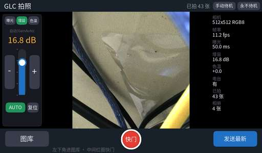
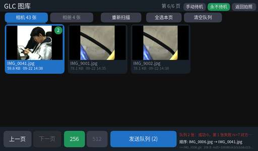

# 基于国产异构芯片 FMQL30TAI 的生成式图像压缩与无线回传系统

**（A 板：采集—压缩—发送终端；B 板：接收—解码—显示终端）**

---

## 摘要

面向窄带链路下的现场图像回传需求，本作品用两块复旦微 FMQL30TAI（悟净 lite）开发板，做出一套**端到端自主**的生成式图像压缩与无线回传系统：A 板取景拍照、板内完成 GLC 模型推理与 rANS 熵编码，经 19.2 kbps 数传电台发出；B 板常驻接收、校验落盘、熵解码与神经重建，并通过 FPGA 原生时序在 1024×600 屏上显示与交互。

系统的核心是**异构算力按特长分工**：A 板用 NPU 承担 GLC 的 1,198 个计算算子、用**自研四相位 rANS 硬件编码器**承担熵编码（200 MHz、8.905 拍/符号）、用 CPU 承担协议与交互；B 板用常驻进程接收与排队、用 CPU 上的 C rANS 与 NPU 分段生成链完成解码、用 FPGA 承担显示扫描与串化。为保证正确性，两端都建立了**逐字节一致**验收：A 板 PL 产物与 PC 参考实现 md5 相同（四相位逐一比对），B 板 36 段 rANS 往返自洽、四象限逐像素匹配。

实测结果：单张 256×256 图像压缩后仅 **308~368 B**（同尺寸 JPEG 实测 19,955 B，压缩比约 **57:1**）；A 板 NPU 推理 **354.87 ms/图**，自研 PL rANS **2.918 ms / 65,536 符号**，相比 A53 软件实现（35 ms）**加速 12.0 倍**且不占 CPU；常驻引擎下每张编码 **1.05 s**，首张发送 **1 s**，上电到出图 **19.5 s**。B 板普通图整图解码 **2.6~2.8 s**（含熵解码与 PNG 写出），原生显示五张逐像素一致，绿点问题经原生 1024×600 时序适配后消失。大图模式（512×512 切 4 块、顺时针拼接）两端协议已对齐，A 侧四个真实向量（268/260/288/268 B，合计 1,084 B）在 B 侧电脑复解四象限逐像素匹配，**尚待实板空口验收**。

两端位流共迭代 9 个版本（V1~V6 攻时序收敛、V7~V9 做显示集成），最终 WNS +0.030 ns、TNS 0、失败端点 0。

---

## 第一部分　作品概述

### 1.1 功能与特性

**A 板（发送端）**

1. 现场取景与拍照：GigE 工业相机，512×512 ROI，触摸屏实时预览，曝光/增益/白平衡三模式与自动曝光。
2. 生成式压缩：板内 GLC 编码（NPU 推理 + FPGA 熵编码），单张压至 308~368 B。
3. 双画质模式：小图（256×256，一帧一图）与大图（512×512 切 4 块顺时针拼接，四帧一张）。
4. 图库与队列：缩略图显示分辨率与大小，跨相册多选、组成队列、逐张发送与失败重试。
5. 无线会话发送：自研会话协议（BEGIN/数据/END/ACK），支持单张与多张。

**B 板（接收端）**

6. 常驻监听与接收：串口只初始化一次、进程不退出，异常输入后仍能继续接收；原子落盘并做 MD5 记账。
7. 解码与重建：C rANS 解熵 + 分段 NPU 重建（S2/S3/S4），写出 PNG；异常数值触发高精度回退路径。
8. 图库与交互：3 行 7 列 21 图图库，翻页、放大、多选删除与恢复，触控响应优化。
9. 原生显示：FPGA 按 1024×600 原生时序扫描输出，解决小屏绿点/条纹问题。
10. 512 大图：四块齐全后无缩放拼接为 512×512，按一张逻辑照片管理。

**两端共同**

11. 自恢复：A 板看门狗与电台自愈；B 板失败次数按内容 MD5 限流、锁与事务提交、断电重启自动恢复。

### 1.2 应用领域

**窄带链路下的现场图像回传**是主场景：

- **无人机 / 巡检机器人**：机载设备把现场图像压缩后经窄带数据链回传，链路常只有几 kbps 至几十 kbps。
- **应急通信与抢险**：公网中断时借助短波/超短波电台回传现场照片，带宽极其宝贵。
- **边远地区与海上作业**：卫星短报文、远距离低功耗链路按字节计费，压缩率直接决定可用性。
- **工业与电力巡检**：设备内部或危险区域，需要本地自主采集并低码率回传、远端实时看图。

共同诉求是：**设备自主（不依赖云端）、链路极窄、交互要现场可用**。本系统以 19.2 kbps 这一最苛刻档位做验证，压缩后单张空口仅约 0.15 s。

### 1.3 主要技术特点

1. **双板异构协同**：A 板 NPU 编码 + PL 熵编码，B 板 CPU 解码 + NPU 重建 + PL 显示；同一套协议贯通空口两端。
2. **自研四相位 rANS 硬件编码器**：纯整数、四路并行，200 MHz 下 8.905 拍/符号、22.5 M 符号/s；CDF 紧凑表 27,256 项 / 0.83 Mb，占 BRAM 容量 9.38%（照抄上游填充表需 68.99%）。
3. **逐字节一致的验收方法**：A 板 PL 产物与 PC 参考实现 md5 相同；B 板 36 段 rANS 往返自洽、四象限逐像素匹配。
4. **常驻引擎 + 后台预热**：A 板 5 个子图常驻，首张发送 17 s → 1 s；B 板常驻会话 + 备用模型预载，解码 2.6~2.8 s。
5. **原生显示适配**：按实读 EDID 做 1024×600、50.25 MHz 原生时序，解决 1080p 降采样导致的绿点/条纹。
6. **模型只读镜像**：B 板把 1.045 GB 模型压成 134,107,136 B 的 SquashFS 只读镜像，按需解压、页面可回收。

### 1.4 主要性能指标

| 项目 | 指标 | 口径 |
|---|---|---|
| 压缩后单张 | **308~368 B** | A 板实测，256×256 q=0 |
| 压缩比 | **≈57 : 1** | 19,955 B ÷ 350 B |
| A 板 NPU 推理 | **354.87 ms/图** | S1 346.72 + S2 2.56 + S3×3 |
| A 板 PL 熵编码 | **2.918 ms / 65,536 符号** | 8.905 拍/符号 @200 MHz |
| FPGA 加速比 | **12.0×** | 对比 A53 软件 35 ms，输出逐字节一致 |
| A 板单张编码 | **1.05 s/图**（常驻） | 冷启动 6.6~13.6 s 仅一次 |
| A 板首张发送 | **1 s** | 优化前 17 s |
| B 板整图解码 | **2.6~2.8 s** | 含熵解码与 PNG，非纯 NPU |
| 空口（19.2 kbps） | **≈0.15 s/张** | 350 B |
| 上电→A 板首帧 | **19.5 s** | 优化前 23.75 s |
| B 板启动里程碑 | **11.1 / 12.0 / 31.4 / 43.1 s** | 首帧/监听/普通模型/全部备用 |
| 位流 | 9 个版本，最终 **WNS +0.030 ns、TNS 0** | Vivado 时序报告 |

### 1.5 主要创新点

1. 把 rANS 熵编码做成**四相位硬件流水**并与 NPU 推理重叠，12× 于 CPU 且释放 CPU。
2. 建立**逐字节一致**的软硬件等价验收，让 FPGA 正确性可复现。
3. **紧凑 CDF 表**把 BRAM 占用从 68.99% 降到 9.38%，为时序收敛腾资源。
4. **大图用 4×256 分块复用已验证链路**，不改模型即把分辨率提升一倍，两端按 SEQ 归位拼接。
5. **常驻引擎 + 后台预热**（A）与**常驻会话 + 只读模型镜像**（B），把首张与启动代价压到最低。

### 1.6 设计流程

需求与场景分析 → 平台能力测绘 → 模型拆分与量化（6 子图 × 3 精度 = 18 次编译）→ A 板推理打通（1,198 算子零回退）→ rANS 硬件化与 9 个位流版本迭代（V1~V6 时序、V7~V9 显示）→ 软硬件逐字节对齐 → A 板交互与协议 → B 板常驻接收与解码链路 → B 板原生显示适配 → 两端协议对接（含 512 大图）→ 性能优化（常驻/预热/镜像）→ 稳定性加固（看门狗、自愈、限流）→ 全量归档与复现验证。

---

## 第二部分　系统组成及功能说明

### 2.1 整体介绍

```
┌────────── A 板（FMQL30TAI）──────────┐        ┌────────── B 板（FMQL30TAI）──────────┐
│ PS：抓帧 / 触摸UI / 会话协议 / 看门狗 │        │ PS：常驻串口接收 / 校验落盘 / 队列    │
│ NPU：GLC 编码 S1+S2+S3（1,198 算子）  │        │     C rANS 解码 / 张量胶水 / 图库     │
│ PL：rANS 四相位熵编码 + HDMI 显示时序 │        │ NPU：S2/S3 先验 + S4 五段重建         │
│                                       │        │ PL：帧读取 + 原生 1024×600 显示时序   │
└───────┬───────────────────┬───────────┘        └───────┬──────────────────┬───────────┘
     GigE│                UART│                    UART│              HDMI│
   MV-CE013-50GC        TP5603 电台（19.2 kbps）      TP5603        1024×600 触摸屏
```

**模块关系**：A 板相机帧经 PS 抓取入共享内存，UI 显示并保存；发送时 PS 调常驻引擎，张量送 NPU 执行 S1/S2/S3，符号流交 PL 做四相位 rANS，结果回 PS 封装 GLC2 容器，经会话协议从串口发出。B 板常驻进程收到帧后校验并原子落盘，入队解码：C rANS 解出 latent，NPU 分段重建，写 PNG，再由 PL 按原生时序扫描上屏。两端以 `AA55|SEQ|LEN|PAYLOAD|SUM8` 帧格式与 BEGIN/END/ACK 会话交互。

### 2.2 硬件系统介绍

**2.2.1 硬件整体**

系统由两块 FMQL30TAI 开发板、一台 GigE 工业相机、一对 TP5603 数传电台、两块 1024×600 触摸屏组成。两块板均使用赛题指定平台，**未自行设计主板**。

| 部件 | 型号/规格 | 接口 | 作用 |
|---|---|---|---|
| 异构开发板 ×2 | 复旦微 FMQL30TAI（悟净 lite） | — | PS/NPU/PL 三算力，运行 Linux |
| 工业相机 | 海康 MV-CE013-50GC | GigE | 1280×960 传感器，取 512×512 ROI |
| 数传电台 ×2 | TP5603 | UART 115200 | 空口 19.2 kbps 透传 |
| 触摸屏 ×2 | 1024×600 | HDMI + USB 触摸 | 交互与显示 |

**2.2.2 机械设计**

**未自行设计机械结构**：两块板与相机、电台、屏采用标准形态与固定支架组装为桌面演示终端，无 CAD 结构件。

**2.2.3 电路各模块介绍**

**未自行设计电路板**，全部电学连接沿用官方板卡接口：

| 连接 | 信号 | 参数 |
|---|---|---|
| A 板 ↔ 相机 | 千兆以太网（GigE Vision） | A 板 192.168.1.10/24；相机 192.168.1.2；512×512×3 @15 fps ≈ 11.8 MB/s |
| A/B 板 ↔ 电台 | UART 透传 | 115200 8N1；空口 19.2 kbps；AT 指令配置频率/符号率 |
| 板 ↔ 屏 | HDMI（PL 时序） | A 板 1024×600 RGB565；B 板原生 1024×600 @50.25 MHz |
| 板 ↔ 触摸 | USB HID | `/dev/input/event0` |
| PL ↔ PS | AXI | NPU 寄存器 `0x40000000`、DMA `0x80000000`；rANS 版本寄存器 `0x400C0084` |

> B 板显示关键参数（实测）：活动区 1024×600、总扫描 1344×625、像素时钟 50.25 MHz、5 倍串化 251.25 MHz、刷新 59.82 Hz、RGB565 单帧 1,228,800 B、H 前肩/同步/后肩 44/88/188、V 3/6/16、H 正 V 负。

### 2.3 软件系统介绍

**2.3.1 软件整体介绍**

**A 板**：开机链 `glc-boot.service → glc_boot.sh → load_bitstream.sh（写位流+15%进度条）→ 等 rc-local → start_ui_gige.sh（45%/90% 进度条、抓帧、电台预热、引擎预热、UI）`，另有 `cam_watch.sh` 看门狗。

**B 板**：系统服务先起监听（串口只初始化一次），模型按需准备（普通模型与备用模型分离），解码队列与图库服务常驻；显示由 PL 原生时序扫描。

**2.3.2 软件各模块介绍**

**A 板**

| 模块 | 职责 | 关键输入 | 关键输出 |
|---|---|---|---|
| `gige_grab.py` | GigE 取帧、ROI 居中 | 相机 IP、512×512 | `/dev/shm/gigecam.bin` + `.meta`（W H SEQ TS） |
| `glc_ui.py` | 取景、曝光/增益/白平衡、图库、队列、发送调度 | 帧、触摸事件 | 画布 RGB565 → DDR、发送命令 |
| `send_image.sh` | 预处理（整幅缩放/切块）、调常驻引擎、封装容器 | 图片路径、`--big/--small` | `send_work/latest/<stem>.glc` |
| `glcenc_daemon.py` | 常驻引擎：载入编码端 5 子图，处理编码请求 | 256×256 张量 | GLC2 容器字节流 |
| `glc_board_full.py` | 单次编码驱动：调 NPU 子图、调 PL rANS、打包 | 输入张量 | 容器 + `pl_words`（拍数） |
| `A_send_session.py` | 会话协议：AT 自检、BEGIN、逐帧、END、ACK | 容器文件、`--mode`、`--orig` | 空口字节、`rc` |
| `at_warm.sh` / `warm_engine.sh` | 电台 AT 预热 / 引擎后台预热 | 设备节点、固定测试图 | 状态标记、`warm.log` |
| `boot_splash.py` | 开机进度条（15/45/90%） | 百分比、文案 | DDR 帧 + 显示寄存器 |

**B 板**

| 模块 | 职责 | 关键输入 | 关键输出 |
|---|---|---|---|
| 常驻接收器 | 串口一次初始化、持续等 BEGIN、分包校验 | 串口字节流 | 校验后的容器 |
| 原子落盘 | 临时写入 + 刷新 + 原子替换；按会话号命名续号 | 容器、会话号 | 持久化文件 + MD5 账本 |
| 解码队列 | 分「收到/排队/解码中/成功/超限失败」；按内容 MD5 限流 | 文件 | 队列状态 |
| `rans_ad_np.py` + `rans_fast.so` | C rANS 解码（真实固定熵表 `elic_entropy_tables.npz`） | 容器分段 | latent 张量 |
| `resident_engine.py` | 常驻 NPU 会话、备用模型预载 | 张量 | 重建张量/PNG |
| `decode_board_s4split5_fast.py` | S4 五段生成链，异常数值触发高精度回退 | latent | 重建图像 |
| `glc_view.py` / `run_demo.py` | 21 图图库、翻页放大、多选删除、监听开关 | 触摸事件 | 界面与操作 |
| 显示通路 | 帧打包 + DMA + PL 扫描输出 | 图像缓冲 | HDMI 1024×600 |
| SquashFS 模型镜像 | 11 段 22 个模型文件只读镜像（134,107,136 B） | — | 按需解压的模型 |

**关键流程（A 发一张 → B 显示一张）**

```
A: 用户按"发送队列" → 检查电台标记(命中则跳过 AT) → 缩放/切块 → 常驻引擎编码 → 容器
   → 容器大小校验(>1,200 B 先重编,仍异常则跳过并记"第几张")
   → BEGIN(N/MODE/长度/原图信息) → 逐帧 → END → 等 ACK
电台: TP5603 透传 19.2 kbps
B: 常驻接收 → 校验 → 原子落盘 + MD5 账本 → 入队
   → C rANS 解熵 → NPU S2/S3 先验 → S4 五段重建 → PNG
   → 图库更新 → PL 原生时序扫描上屏
```

**协议约定（两端一致）**

| 变量 | 含义 | 取值 |
|---|---|---|
| `MODE` | 画质模式 | 0=小图（256×256，一帧一图）；1=大图（四帧拼 512×512） |
| `N` | 本次会话帧数 | 小图=张数（≤254）；大图=4 |
| 大图顺序 | 拼接位置 | SEQ 1 左上、2 右上、**3 右下**、4 左下（顺时针） |
| `ORIG` | 原图信息 | 宽(2B) 高(2B) 字节数(4B)，供 B 显示压缩比 |

---

## 第三部分　完成情况及性能参数

### 3.1 整体介绍

【待补：实物照片——A 板与 B 板各一张正面、斜 45° 全局照】

系统当前形态：两块板 + 相机 + 一对电台 + 两块触摸屏；A 板上电自动进入拍照界面，B 板上电自动进入监听与图库界面。

### 3.2 工程成果

**3.2.1 机械成果**：无自行设计结构件。

**3.2.2 电路成果**：无自行设计 PCB；均使用官方开发板，位流经 `fpga_manager` 热加载。

**3.2.3 软件成果**

A 板拍照界面与图库界面、编解码对比：






> 以上为 A 板界面截图；B 板 21 图图库与原生显示实屏照片【待补】。

### 3.3 特性成果（逐项量化）

| 功能/特性 | 量化结果 | 测试方式 |
|---|---|---|
| A 压缩能力 | 单张 308~368 B，压缩比 ≈57:1 | 多张现场图，读容器字节与 md5 |
| A 编码速度 | 常驻 1.05 s/图；冷启动 6.6~13.6 s | 板端时间戳 |
| **FPGA 加速** | 2.918 ms vs 35 ms = **12.0×** | 同输入 65,536 符号，输出逐字节一致 |
| 熵编码吞吐 | 22.5 M 符号/s（8.905 拍/符号 @200 MHz） | 读 `pl_words` 拍数 |
| 时序收敛 | WNS +0.030、TNS 0、失败端点 0 | Vivado 报告（V9） |
| 资源占用 | LUT 37,745(48.02%)、FF 53,587(34.09%)、BRAM 252.5、DSP 25 | `report_utilization` |
| 位流迭代 | 共 9 个版本（V1~V6 时序、V7~V9 显示） | 每版均做时序 + 4/4 相位验证 |
| 分辨率扩展 | 256 全链 955.97 ms；512 全链 4,371.20 ms | 板端分段计时，分段与整段 md5 相同 |
| A 开机速度 | 19.5 s（原 23.75 s） | uptime 打点 + 日志 |
| A 首张发送 | 1 s（原 17 s） | 按发送到容器就绪 |
| 窄带发送 | 空口 ≈0.15 s/张；ACK 0.20~0.22 s | 19.2 kbps 实测 |
| **B 解码速度** | 普通图 2.6~2.8 s；双备用 4.7~4.8 s | 服务内整图解码（含熵解码/PNG） |
| B 启动里程碑 | 11.1 / 12.0 / 31.4 / 43.1 s | 软件重启计时（非按电源） |
| B 显示 | 原生 1024×600，五张逐像素一致，绿点消失 | 实屏验收 + 位流 MD5 绑定 |
| B 模型镜像 | 1.045 GB → 134,107,136 B | SquashFS 只读镜像 |
| **512 大图** | A 四块 268/260/288/268 B=1,084 B；B 四象限逐像素匹配 | B 侧电脑复解 + 197 条离线断言（**未实板**） |
| 稳定性 | 看门狗重启、电台自愈、异常帧拦截、按 MD5 限流 | 人为断链/断相机/注入异常 |

---

## 第四部分　总结

### 4.1 可扩展之处

1. **模型侧**：板端 INT8 之外，BF16/TF32 已验证可运行；512 原生模型已测通，可替换 4×256 分块。
2. **硬件侧**：rANS 可扩至八相位；BRAM 尚有约 50% 余量，可把缩放/切块下到 PL；B 板独立 PL rANS 已有仿真与综合证据，可进一步做整机集成。
3. **链路侧**：协议已带逐帧长度与原图信息，可扩展分片突破单帧上限；SUM8 可升级为更强的端到端校验。
4. **应用侧**：多相机、本地存储、增量重传；B 板可支持更多画质档位与更大图库。

### 4.2 心得体会

（1000 字内，待补团队个人化内容；以下为可复用经验框架）

本项目最大的收获，是学会**在没有标准答案的硬件问题上，用证据代替猜测**。

早期我们把"能跑通"当成功。但一旦要求"证明它是对的"，很多"通过"就站不住了。于是我们立了三条纪律：**每个数字必须有出处**（板上日志或可复算读数，否则标"外推/未验证"）；**硬件与软件必须逐字节对齐**（rANS 产物与 PC 参考实现 md5 相同才算过，波形好看不算）；**先量化再优化**（不知道耗时分布就动手，容易在只占 0.28% 的环节反复使劲）。

时序攻关是最好的教材。V1 到 V9，我们从"功能能跑但 WNS −1.566 ns"一路做到"+0.030 ns、失败端点 0"。中途 V7 试过另开 HDMI 时钟域——原理更"干净"，但跨域路径让时序崩到 −5.28 ns；改成"换时钟源"这种看似粗暴的做法反而一次收敛。这类经验后来都变成了检查清单。

另一课是**边界意识**。近 5 万行的工程里（446 个源文件 / 49,350 行），真正决定成败的往往是一两个细节：显示地址寄存器按 8 字节寻址、位流配置瞬间必须门控 HDMI、脚本里一个未定义变量能让整个服务静默退出。

最后一课是**协作**。两块板分处两人之手，协议是唯一接口。把"我以为"变成"文档写清 + 测试向量能自证"，比任何口头约定都可靠——我们给对方的是一份协议说明加一段 308 字节的黄金容器，五分钟就能判定解码对不对。也正是这种对齐，让我们在发现一端解出偏色时，能迅速定位到"颜色重建的每通道仿射常数"而非传输层。

### 4.3 参考文献

1. Ballé J., Laparra V., Simoncelli E. P. End-to-end optimized image compression. ICLR, 2017.
2. Ballé J., Minnen D., Singh S., et al. Variational image compression with a scale hyperprior. ICLR, 2018.
3. Minnen D., Ballé J., Toderici G. Joint autoregressive and hierarchical priors for learned image compression. NeurIPS, 2018.
4. Duda J., Tahboub K., Gadgil N. J., Delp E. J. The use of asymmetric numeral systems as an accurate replacement for Huffman coding. PCS, 2015.
5. 复旦微电子. FMQL30TAI 悟净开发板硬件使用手册 V1.0（嵌赛版）.
6. 复旦微电子. Icraft 工具链用户指南（模型转换与量化）.
7. Xilinx. Vivado Design Suite User Guide: Implementation（UG904）.
8. 2026 FPGA 赛道选题指南（复旦微），2026.
9. 全国大学生嵌入式芯片与系统设计竞赛 FPGA 创新设计赛道竞赛说明，2026.
10. DWE2100 液晶模组规格书（EDID 时序参数）.
