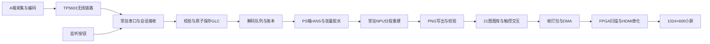

# B端系统技术报告

## 1. 范围与交付状态

本报告整理低带宽生成式图像压缩与无线回传系统中B端的实现。覆盖早期DSH工作与后续Codex完成的复现、解码、通信、FPGA显示、交互、性能优化和故障排查。A端采集与编码由队友负责；GLC模型及厂商NPU工具链为复用依赖，不能计作B端从零研发。

本次是本机资料与代码交付核查，没有连接板子。最后有完整实屏反馈的基线为2026-10-23原生1024×600版本；新增512接收与拼图为2026-10-24离线就绪v2，尚待真实接板验收；最新红图的最终根因尚未确定。下文分别标明实际采用、独立验证和待验证内容。

项目历史文件使用过不同平台简称。B端显示工程采用的FPGA器件配置与实际板卡名称、赛题平台称呼应分别说明；不直接沿用旧报告中FMQL100TAI或FMQL30TAI的混杂称呼作为整队最终平台型号，正式封面以实物及团队确认信息为准。

## 2. 应用需求与系统结构

系统针对带宽受限的图像回传场景：A端把图像转成GLC码流，经TP5603数传电台发送；B端常驻接收，校验、落盘、排队，完成熵解码与神经重建，再通过HDMI显示。B端应持续等待下一批图像，允许用户查看、翻页、放大、多选删除和控制监听，并在异常输入或数值异常后保持后续处理能力。

实际生产分工如下：

| 承载 | 任务 | 选择依据 |
|---|---|---|
| PS/Linux | 串口协议、文件系统、会话、rANS C扩展、张量整理、队列、状态与触控 | 分支、动态状态、异常处理和系统服务适合软件实现 |
| NPU | S2/S3先验计算、S4分段生成重建及已准备的数值回退段 | 卷积等算子通过厂商工具链部署；常驻模型减少反复建会话和加载 |
| FPGA | 当前已集成的帧读取、显示时序、TMDS/HDMI输出等 | 固定吞吐的视频扫描与串化需要确定时序；按屏幕输入能力适配 |
| 独立PL rANS研究 | 符号搜索、区间更新、归一化、流水与预取 | 有独立仿真和综合实现证据，尚无替换生产PS rANS的整机验收证据 |

FPGA显示和独立PL rANS都需要说明来源、接口、约束与验证。不能把独立IP的仿真周期加速直接写成当前整机板测加速。

## 3. 模型复现、转换与解码链路

### 3.1 从参考实现建立边界

早期工作先建立GLC官方源码、checkpoint、Python与compressai环境，确认原始图像、码流头部、量化参数、熵表及解码输出的对应关系。官方模型是复用部分；团队补齐真实rANS码流、z索引打包与GLC2容器、板端胶水及互解验证。使用Kodak24等固定输入，保存编码字节数、bpp、PSNR和电脑耗时；再做模型拆图、ICraft适配/生成、HostBackend输入输出dump及误差分析。

HostBackend是电脑后端。早期逐子图使用fp32校准输入并静态灌回输出的对比图，有助于排查局部算子和量化误差，但不是同一份码流在板上完成端到端解码的证据。后续真实上板和来图复解分别保留，不互相替代。

### 3.2 实际解码过程

1. 解析GLC容器，检查magic、版本、标志、分段长度与总长度，按头部维度解包，拒绝截断或多余填尾；保存原始数据用于追溯。原256路径并无新增512入口的固定形状/q0白名单，二者验证能力分别说明。
2. 解出z索引并通过固定码本恢复超先验输入。
3. 执行S2和分阶段S3网络，计算解码所需概率参数；rANS按一致的CDF、scale索引、均值与符号顺序恢复y。
4. 对还原张量做必要通道/空间整理，送入S4五段生成链。
5. 检查各段输出，按现有数值异常判据触发对应高精度重算路径。
6. 将最终重建结果写成PNG，成功校验后更新与源文件MD5绑定的账本。旧256路径直接写最终PNG，不能称为已实现原子PNG替换；新增512路径在四块全部成功后原子提交整图。

生产rANS使用`rans_ad_np.py`及同目录`rans_fast.so`，C源码和构建脚本同时交付；`elic_entropy_tables.npz`为真实固定表，不能用“缺表时能尝试生成”替代逐位一致性要求。三份固定常量是`z_codebook.npy`、`ysp_reduce_w.npy`和`ysp_reduce_b.npy`。

S4采用分段方案，减少单图不可部署或资源不足的约束；部分fp16中间结果存在溢出风险，因此保留特定段的tf32回退。原链路故障包括全白、陈旧结果或异常耗时，修复过程涉及输出有效性、运行环境恢复、常驻会话和逐帧设备复位，不宜把所有异常归为同一个原因。

### 3.3 常驻、并发和故障隔离

常驻引擎一次创建并保持模型会话，后续图像复用已加载模型；备用模型提前准备，降低首次触发回退的额外等待。逐次调用仍遵守设备互斥和输入输出生命周期，防止显示与推理同时争用硬件。

硬件锁、引擎内部线程锁、图片目录事务锁解决不同问题。锁等待超时可能返回未持有状态，调用者必须检查；不能笼统宣称加锁后绝无并发风险。旧生产普通解码和后台备用部分调用未显式检查held，属于本次归档核出的已知边界，未在资料整理中修改代码。新512批处理明确要求锁有效后才执行单块，失败不提交整图。

队列将“收到”“排队”“正在解码”“成功”“同内容失败次数达到限制”分开。曾出现PNG缺失分支绕过失败次数限制、导致相同异常文件无限重试；修复后按MD5限制相同内容，文件内容改变仍有新重试机会。删除操作和解码完成提交受目录锁约束，避免文件一边删除、一边被后台恢复到图库。

## 4. 无线接收与图片生命周期

### 4.1 协议与常驻接收

无线数据沿用`AA55 | SEQ | LEN(大端2B) | payload | SUM8`封装及既有BEGIN/END/ABORT/RETRY、ACK/NAK规则。具体常量、超时和串口初始化以交付源码为准，不从旧操作卡手抄一套新协议。

早期单次接收脚本收完一个会话即退出；A端触屏发送队列采用一张一个会话，因而出现仅第一张能接到、后续BEGIN无人确认。B端改为串口只初始化一次、进程持续运行、会话间不退出，减少重复AT握手盲窗。保存名加入会话编号并在启动时续号，防止不同会话的SEQ从1开始而覆盖同名图片。

接收成功必须对应可持久保存的数据，文件采用临时写入、刷新与原子替换等方式提交。旧模式并不是“数够N帧立即结束”，还需要处理结束控制、补发或空闲超时。新增模式涉及大图时，对嵌套BEGIN严格保留会话边界，防止把两次发送拼在一起。

SUM8只能检出部分错误。已构造两字节相抵修改仍通过SUM8、但MD5变化的反例。因此本地保存后计算MD5不能证明空口之前原文件与之后相同；精确判断需A端发送前摘要或双方一致的更强端到端校验。本次交付没有单方面改动两端无线格式。

### 4.2 上电监听和交互

监听服务与模型准备分离，系统达到必要设备条件后即可先打开串口并等待BEGIN，不必等所有NPU模型加载。屏上监听开关作用于常驻接收器状态，不每次重开串口。普通模型尚未就绪时可先保存图片，之后按队列解码。

本轮计数按每次开启监听统计，关闭后再次开启清零。它不是A端发送队列编号：原协议没有整批队列标记，接收端不能凭猜测准确识别发送端批次边界。底栏Receive、Decode、Queue、Last、Batch等含义按当前源码与交互文档解释，不混用早期百分比/布局切换版本。

### 4.3 512模式的新增规则

MODE=0保留一帧一张256图；MODE=1必须N=4。四块均为现有256×256 GLC，SEQ顺序为1左上、2右上、3右下、4左下，即顺时针。四块来自同一会话，齐全后才生成一张逻辑512图片。

大图原码流以本地无压缩`.glc512`包保存，内含四份原GLC、顺序和摘要。无线封装不变。乱序按SEQ归位；同一会话中同SEQ、同内容重发不新增图片，新会话独立计数；同序号不同内容、非法MODE/N、长度和容器不符会拒绝；缺块仅留隐藏会话状态，不把半张图放进图库。

解码按现有引擎依次执行四块，全部成功后无缩放、无平滑地拼接并原子发布512 PNG。接收、轮次、解码、排队和多选删除按一张逻辑照片处理；删除/恢复保留整包。缩略图和放大标题均显示512×512。当前新增路径只接受与既有固定q0 S4合同匹配的输入，不声称支持其他q。

此功能已通过197条离线断言和A侧四个真实向量的电脑复解，但未实板验收。现有测试拼图可见分块接缝，无原始512照片可计算重建质量，不能把像素粘贴正确说成接缝或感知质量已经达标。

## 5. 显示与触控

### 5.1 图库和交互

当前界面固定3行7列21张，保留前后翻页、点图放大、再次点击或返回按钮退出、多选、取消、确认删除与恢复上一批。状态提示和模型加载信息移至底栏，避免遮挡图片；监听按钮只保留一个。

触控响应优化把采集与较慢的渲染/推屏工作分开，保留事件顺序和确认删除边界，并缓存可复用页面与图像结果。用户曾确认响应明显加快、放大返回正常，以及21图与监听开关正常。软件测量要明确从触摸哪个事件起算至推屏命令完成，不能把注入事件的毫秒级API返回当作实际手指到液晶响应。

### 5.2 原生显示适配与绿纹

此前1080p60输出在小屏上出现固定位置闪烁的绿点/条纹；相同板接大显示器正常，小屏接电脑正常，换短线有改善，供电来源切换未改善。多次编码、时钟滤波、倍频和相位候选均未获用户光学改善；1080p30对照出现黑屏/异常并已回退。

最终按实读EDID与小屏原生1024×600能力适配，使用本板器件、晶振和管脚，参考队友V9的扫描/时钟关系而非直接装其位流。当前参数如下：

| 参数 | 已验收值 |
|---|---:|
| 活动像素 | 1024×600 |
| 总扫描 | 1344×625 |
| 像素时钟 | 50.25MHz |
| 5倍串化时钟 | 251.25MHz |
| 每条TMDS数据速率 | 0.5025Gb/s |
| 刷新率 | 59.82143Hz |
| H前肩/同步/后肩 | 44/88/188 |
| V前肩/同步/后肩 | 3/6/16 |
| 同步极性 | H正、V负 |
| 显存像素格式/单帧 | RGB565 / 1,228,800B |

保留1920×1080逻辑UI与触控坐标，在最终送屏边界重采样至原生大小；保存的原始PNG不变。用户最终确认“绿点已消失，画面稳定”。证据定位到输出时序/传输速率与屏幕输入链路的适配；没有HDMI眼图，不能进一步认定具体芯片或走线故障。

历史24位显示曾以32bit/像素存储尝试突发和读通路改造，出现欠载/丢行，未作为已验收方案。RGB565及历史抖动方案的视觉效果也不意味着恢复了丢失的RGB低位。最终报告描述实际采用方案即可，失败路径在演进文档保留。

## 6. 启动过程优化

启动分为首帧、监听、普通模型、全部备用模型四个可观测里程碑。优化采取早期服务、设备节点就绪判断、标准库监听启动、受硬件锁保护的显示与模型准备重叠，以及模型只读SquashFS镜像。

镜像内为11段、22个JSON/raw文件，约1.045GB原始模型压缩为134,107,136B；原记录逐文件完整MD5相同。模型按需解压、页面可回收。适配5.4.52/aarch64内核的SquashFS模块在任务目录构建，校验配置、vermagic和模块摘要，未更换内核或BOOT文件。校验或挂载失败时回到原模型路径。

启动封存记录还包含镜像的size、mtime_ns、ctime_ns、inode、dev。复制文件后这些身份会改变，需要先独立校验镜像完整SHA256，再使用已交付封存工具重新建立记录；seal工具本身不计算镜像完整SHA256。不能把历史`native_image_verification.json`原样复制后就宣称加速已生效。恢复时应先恢复原模型fallback，再启用加速并核实实际模型源。

大RAM缓存和某些后台并行尝试在真实来图时出现OOM或总准备退步，已撤回，不属于最终采用方案。

## 7. 验证与可引用结果

验证同时关注数值、字节、状态、硬件与光学：固定模型/码流摘要、熵解码再编码逐字节一致、参考PNG对拍、异常会话/失败重试、文件事务、锁和恢复、原生时序实现报告、真实小屏观察。完整数字和测量边界见[性能与证据口径](03_性能正确性与事实纠错.md)。

最后原生显示生产回归记录：五张图逐像素一致，普通图服务内整图解码约2.6～2.8秒，双备用约4.7～4.8秒；包括熵解码、PNG及可能的锁等待，不能称为纯NPU计算，真实队列等待另计。此前四阶段软件重启记录为内核起首帧11.149秒、监听12.015秒、普通31.38秒、全部备用43.14秒。显示切为原生后尚未重新进行完整断电秒表测量，因此不能称为最终电源按钮起计耗时。

2026-10-24电脑独立复解13次真实来图、去重9份，36段rANS往返自洽，并在电脑复现红图及另一张异常图。自洽只证明同一路径能往返，不证明适配对方实际编码后端；红图仍需发送前码流、正常解码脚本与模型对齐。已证明一个本地控制样本中约3e-8尺度差跨CDF索引边界会破坏熵解码，但没有据此认定真实红图的最终原因。

## 8. 可复现交付和剩余验收

源码按最后已验收根树、512待实板候选和历史版本分别保存。模型镜像、真实常量与熵表、C源码/目标库、模块、位流、显示工程依赖、构建脚本和来源清单一起交付；厂商SDK、匹配的系统内核/驱动与工具许可证列为环境依赖，不整套复制Python环境或60GB整卡镜像。

接板后先核对当前基线与已记录摘要，发送端空闲时使用512 v2的既有部署入口；自动备份、安装、等待普通/备用准备，并以真实NPU比较四张独立256结果与512四象限。再验实际空口、触控、大小图混合、断电启动和持续运行。失败保留现场并按本轮备份回滚。

报告定稿仍需补：512实板与原图质量、红图兼容性闭环、冻结版本的冷启动/混合连续批次和演示视频、团队身份与正式提交模板。当前技术资料已足够写背景、架构、实现和优化过程，未验收内容必须维持明确状态。

## 9. 证据导航

- [历史逐步原文](../02_源资料归档/README.md)：四区全部收录MD与历史源码，来源摘要见清单。
- [实现与改进历程](02_实现步骤与改进历程.md)：每一步的问题、处理、证据、采用状态。
- [性能、正确性和事实纠错](03_性能正确性与事实纠错.md)：防止跨版本或跨测量对象引用。
- [当前生产来源核查](../90_审查底稿/current_code/source_baseline.json)：生产路径、文件与摘要。
- [本次早期复现核查](../90_审查底稿/early_temp/)与[DSH历史核查](../90_审查底稿/dsh_history/)：重新读取原始数据的结果。
